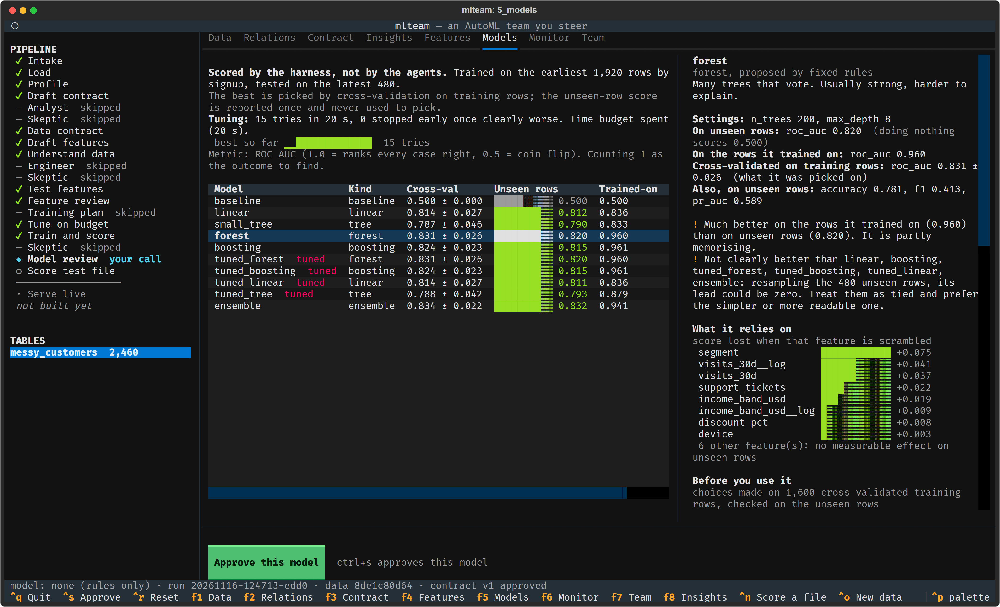
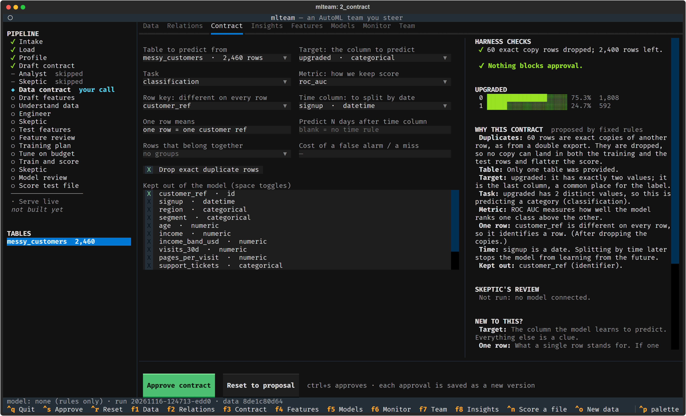
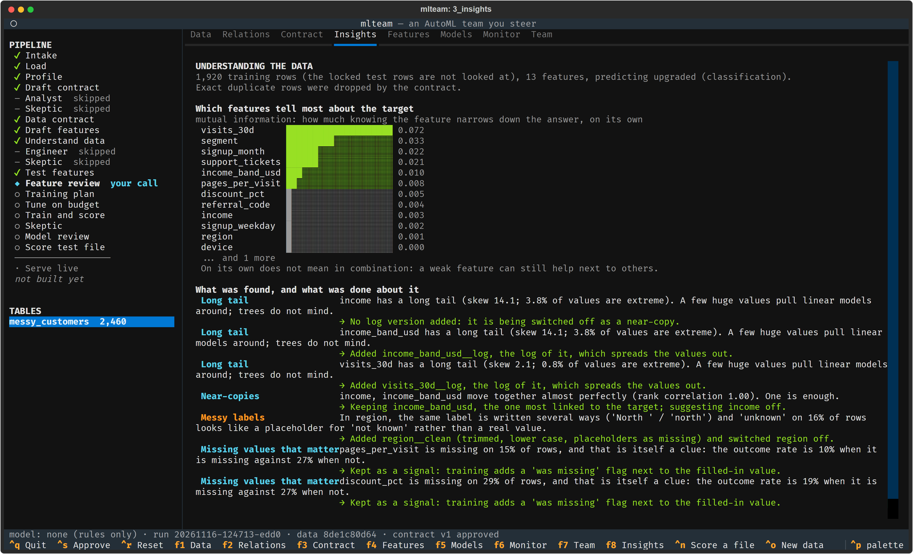
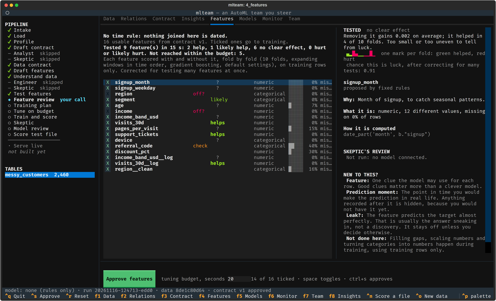
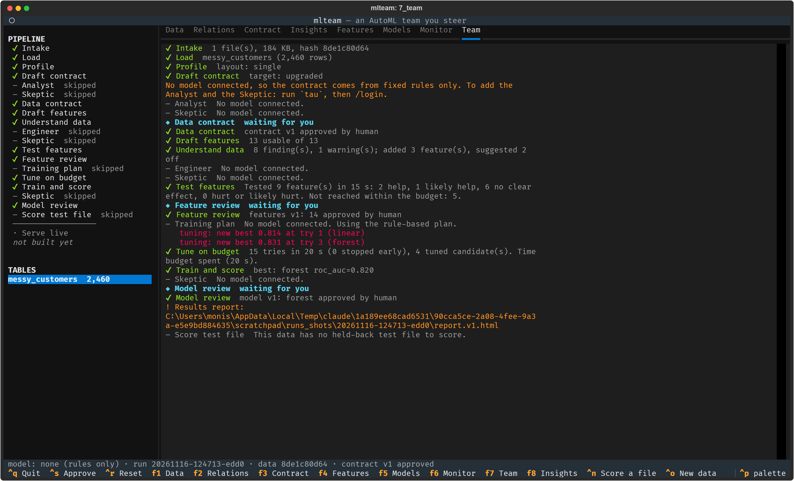
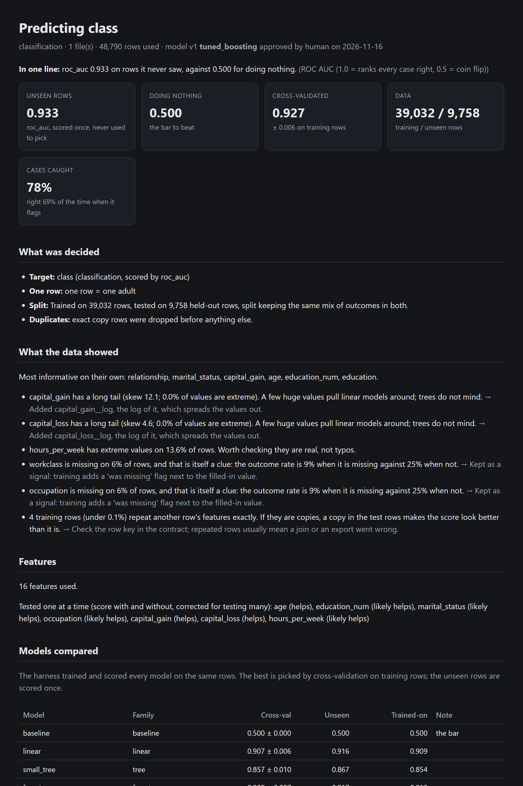

# AutoML Team

**A machine-learning team in your terminal.** AI agents do the work, a strict harness
sets the rules, and you make the calls that matter. Give it a CSV (or a folder of them,
or a Kaggle dataset) and it walks the same road a good ML team does: understand the
data, agree what to predict, build and test features, tune on a budget, pick a model
honestly, check it is fair and usable, hand over a report, and watch it after launch.

It is built to be **learned from**, not just used. Every decision is shown, explained in
plain words, and saved, so someone new to ML can see *why* a model is good or bad, not
only a number.

```bash
uv run python -m mlteam demo:shop          # opens the app on a sample dataset
uv run python -m mlteam your_data.csv      # or your own data
```

> The Python package and command are called `mlteam`.



---

## Why this exists

Most AutoML tools are a black box: data goes in, a leaderboard comes out. That is
fast, but it hides the part that decides whether a model works in the real world, and
it teaches nothing.

Real ML teams spend most of their time on judgement calls:

- *What exactly are we predicting, and at what moment?* (Predicting with information you
  would not have yet is the most common way models fail.)
- *Is one row one customer, or did duplicates sneak in?*
- *Does this feature really help, or did it look good by luck?*
- *Is the best model really better, or just better on this test split?*
- *Where should the yes/no cut-off be, given what a mistake costs?*
- *Does it treat groups of people differently?*
- *Has the data drifted since we trained, and is the new model actually better?*

Language models are good at proposing answers to these questions and bad at grading
their own work. So this project splits the jobs:

| Who | Does | Never does |
|---|---|---|
| **Agents** (Analyst, Engineer, Skeptic) | Read the data, propose a contract, invent features, plan models, review each other | Score anything, approve anything, talk to each other directly |
| **Harness** | Fixes the order of steps, validates every proposal, trains and scores every model the same way | Guess at business decisions |
| **You** | Answer the questions only a person can, approve at three gates | Write code (unless you want to) |

The result is an AutoML loop you can trust *and* follow. The idea came from asking
what a real ML team needs: the right data, a well-designed harness, memory and
versioning, a person in the loop at the critical steps, and evals that cannot be gamed.

## What it does

**Data in**
- One file, a folder, a zip, a glob, or a Kaggle dataset/competition
- Works out how several files relate: copies to stack, tables to join, or a train/test split
- Read-only, hashed copies; a sealed DuckDB store that agents can query but never change

**Understanding and agreeing on the problem**
- Profiles every column; finds IDs, dates, duplicates, messy labels, long tails, near-copies, informative gaps
- Drafts a **data contract** (target, task, metric, row key, time split, joins, leak suspects) that the Analyst refines and the Skeptic reviews
- Asks you what the data cannot answer, and will not continue until you do

**Features**
- One feature per usable column, a time rule so joined data never leaks from the future, plus Engineer ideas tried before they are accepted
- Every feature **tested**: the score with and without it, fold by fold, corrected for testing many at once

**Models**
- Baseline, linear, tree, forest, gradient boosting, and an ensemble of the best of each
- **Bayesian tuning on a time budget** (Optuna TPE, early stopping of hopeless tries, successive halving across families)
- Picked by cross-validation on training rows, never by the test score; ties are called ties

**Before handover**
- Yes/no **cut-off** chosen for F1 or for your **costs** (a missed case vs a false alarm)
- **Calibration**: does "70%" mean 70%? Rescaled only when that helps on held-apart rows
- **Ranges** for numeric predictions (an 80% interval that is checked on unseen rows)
- **Fairness** by group (age, sex, race, ...): separates gaps already in the data from gaps the model widens
- **Grouped splits** so the same customer is never in both training and test
- A self-contained **HTML results report** for the person who asked the question

**After launch**
- Score new files with a **drift check** (PSI, corrected for chance) and a plain verdict: stable / watch / retrain
- **Champion vs challenger**: retrain on new labelled rows, compare fairly, promote only if not worse

## How it works

```mermaid
flowchart LR
    A[Your data] --> B[Intake and profile]
    B --> C[Analyst drafts contract]
    C --> D[Skeptic reviews]
    D --> G1{{You: approve contract}}
    G1 --> E[Understand data and draft features]
    E --> F[Engineer adds features]
    F --> S2[Skeptic reviews]
    S2 --> T[Feature tests]
    T --> G2{{You: approve features}}
    G2 --> P[Engineer plans models]
    P --> U[Bayesian tuning on a budget]
    U --> H[Harness trains and scores all]
    H --> S3[Skeptic reviews]
    S3 --> G3{{You: approve model}}
    G3 --> R[Results report and predictions]
    R --> M[Monitor drift and retrain]
```



### A look inside

| | |
|---|---|
|  **Data contract**: what to predict, what one row is, what is kept out and why |  **Understanding the data**: what tells most about the target, and what was cleaned |
|  **Features**: each one tested with and without |  **Team log**: every agent and harness step, live |

And the page you hand over ([open the full example](examples/adult_income_report.html)):



### Architecture

One headless core emits a stream of events; the interface only renders them. The same
core runs the terminal app, the headless text report, and the tests.

```text
┌─────────────────────────────────────────────────────────────┐
│  Frontends     Textual app (tui/)  ·  headless CLI (cli.py) │
└──────────────────────────────┬──────────────────────────────┘
                               │  TeamEvent stream
┌──────────────────────────────▼──────────────────────────────┐
│  Harness (team.py)   stage order · gates · versions · trace │
│                                                             │
│  contract.py  features.py  insights.py  feature_tests.py    │
│  tune.py  train.py  evaluate.py  report.py                  │
│  predict.py  monitor.py  challenger.py                      │
└───────────┬───────────────────────────────────┬─────────────┘
            │ proposals, reviews                │ SQL (read-only)
┌───────────▼──────────────┐       ┌────────────▼────────────┐
│  Agents (agents/)        │       │  Data (intake, store,   │
│  one Tau harness per role│──────▶│  profile, relations)    │
│  own prompt, own tools   │ tools │  DuckDB, sealed         │
└──────────────────────────┘       └─────────────────────────┘
```

Design rules the code enforces:

1. **Nobody scores their own model.** Whatever an agent proposes, the harness builds it
   fresh, fits it on training rows, and scores it on rows nobody has looked at.
2. **The harness decides the order.** Agents never call each other; they hand over
   artefacts (a contract, a feature list, a plan, a review).
3. **A person approves what matters.** Three gates: the contract, the features, the
   model. Nothing becomes real without an approval, and every approval is a new version.
4. **Everything is saved.** Each run folder holds every version, every score, every
   agent step and tool call (`trace.jsonl`), and the final report.
5. **Agents get the least access that works.** SQL is read-only, one statement, 50 rows
   at most, no files and no network; `--stats-only` keeps raw rows on your machine.

Agents run on [Tau](https://github.com/huggingface/tau)'s agent loop (`tau_agent`), with
whatever model provider you connected in Tau. Without a model, every step still runs
on rules, so the whole tool works offline.

## Getting started

### Requirements

- Python 3.13
- [uv](https://docs.astral.sh/uv/) (installs everything else)
- Optional: a model provider through Tau, for the agents
- Optional: Kaggle credentials (`KAGGLE_API_TOKEN` or `~/.kaggle`), for Kaggle imports

### Install

```bash
git clone https://github.com/MonishGosar/automl-team.git
```

```bash
cd automl-team
```

```bash
uv sync
```

### Connect a model (optional)

The agents reuse the provider you log in to with Tau. mlteam never stores API keys.

```bash
uv run tau
```

Then type `/login` inside Tau. Skip this step to run on rules only.

### First run

Try a built-in sample (`loans`, `titanic`, `shop`, `shards`):

```bash
uv run python -m mlteam demo:shop
```

Then your own data:

```bash
uv run python -m mlteam path/to/data.csv
```

The app opens on the **Data** tab. Move through the tabs left to right, answer any
questions on the **Contract** tab, and approve at each gate with `ctrl+s`. `f1` to `f8`
jump between tabs; the footer shows the other keys.

> **Windows note:** if Application Control blocks unsigned executables, use
> `python -m mlteam` instead of the `mlteam` launcher, as shown above.

## Usage

### The app

```bash
uv run python -m mlteam data/ kaggle:owner/dataset
```

| Tab | What you do there |
|---|---|
| Data | See every table and column, what was found, and why |
| Relations | How the files fit together |
| Contract | Target, metric, row key, time split, groups, costs, joins, questions; approve |
| Insights | What tells most about the target, and what was cleaned |
| Features | Tick features on or off, see test results, set the tuning budget; approve |
| Models | Every model compared, what each relies on, the tree drawn as questions, cut-off and fairness; approve |
| Monitor | Score new files, see drift, retrain and promote |
| Team | Live log of every agent and harness step |

### Headless (a text report, good for scripts and CI)

```bash
uv run python -m mlteam data.csv --headless --approve --approve-features --approve-model
```

Useful options:

| Option | Meaning |
|---|---|
| `--no-llm` | Rules only, no model calls |
| `--answer "..."` | Answer the team's questions, once per question |
| `--cost-false-alarm 1 --cost-miss 5` | Pick the cut-off for the lowest cost |
| `--group-column customer_id` | Keep each customer's rows on one side of every split |
| `--fairness COL` | Also check fairness on this column |
| `--tune-seconds 60` | Time budget for tuning |
| `--stats-only` | Agents see statistics only, never raw rows |

### After launch

```bash
uv run python -m mlteam predict latest new_rows.csv      # predictions + drift check
```

```bash
uv run python -m mlteam monitor latest                   # every batch scored so far
```

```bash
uv run python -m mlteam retrain latest labelled_rows.csv # train a challenger
```

```bash
uv run python -m mlteam promote latest 1                 # promote challenger 1
```

```bash
uv run python -m mlteam runs                             # compare all runs
```

## Results on real data

Run end to end, with default budgets:

| Dataset | Rows | Task | Model picked | Unseen rows | Doing nothing |
|---|---|---|---|---|---|
| Adult income (OpenML 1590), agents | 48,842 | yes/no | boosting (Engineer's plan) | ROC AUC 0.933 | 0.500 |
| Adult income, rules only | 48,842 | yes/no | tuned boosting | ROC AUC 0.933 | 0.500 |
| Breast cancer (scikit-learn) | 569 | yes/no | tuned model | ROC AUC 0.98 | 0.500 |
| Wine (scikit-learn) | 178 | 3 classes | tuned model | macro F1 0.97 | 0.19 |
| Diabetes (scikit-learn) | 442 | a number | tuned linear | RMSE 58.6 | 71.7 |
| Messy synthetic customers | 2,460 | yes/no | ensemble / forest | ROC AUC 0.83 | 0.500 |

What happened on Adult income is a good picture of the split of work. The first
rules-only run kept `workclass` out as a possible leak, because its name contains the
target's name (`class`), and scored 0.926. The Analyst overruled that ("its name is
not a reason to drop it") and the agents' run scored 0.933. The rule is now fixed and
matches. The agents also raised the questions a reviewer should: whether sex and race
should be features, the class imbalance, and 54 repeated rows that cannot be told
apart without an ID. The fairness check then showed that the gap between men and
women is already in the data and the model does not widen it, while for age it does.

Example reports (open in a browser):
[Adult income](examples/adult_income_report.html) ·
[Messy customers](examples/messy_customers_report.html)

## Project layout

```text
src/mlteam/
├── intake.py         files, folders, zips, Kaggle → read-only hashed copies
├── store.py          DuckDB store, sealed before agents touch it
├── profile.py        column kinds, IDs, dates, statistics
├── relations.py      how several files relate (stack, join, train/test)
├── contract.py       the data contract: draft, validate, version
├── features.py       features as SQL, time rule for joined tables
├── insights.py       understanding the data, and the cleaning it leads to
├── feature_tests.py  with/without tests, corrected for many tests
├── tune.py           budgeted Bayesian tuning
├── train.py          training, scoring, ensemble, picking by cross-validation
├── evaluate.py       cut-off, costs, calibration, ranges, fairness
├── report.py         the HTML results report
├── predict.py        scoring the test file and new files
├── monitor.py        drift (PSI) and health verdicts
├── challenger.py     champion vs challenger, promotion
├── team.py           the harness: stages, gates, events, versions
├── agents/           Analyst, Engineer, Skeptic: prompts and tools
├── tui/              the Textual app and its renderers
└── cli.py            command line, headless mode, subcommands
tests/                about 130 tests, scripted agents, no network needed
docs/GUIDE.md         the full guide to every stage and rule
```

## Development

```bash
uv run python -m pytest
```

The tests use a scripted model (`tau_ai.fake.FakeProvider`), so they need no API key
and no network. A full run takes about 12 minutes; most of it is real model training.

## Limitations

- Tabular, supervised problems only (classification and regression). No forecasting,
  text, or image features yet.
- Joins go one hop from the main table.
- Gradient boosting is scikit-learn's histogram boosting (the LightGBM algorithm), not
  LightGBM or XGBoost themselves.
- Serving predictions over a network is not built; scoring is file-in, file-out.
- Agents vary from run to run. The gates, the harness checks and the trace are what
  keep that safe.

The full list, with reasons, is in [docs/GUIDE.md](docs/GUIDE.md#limits-so-far).

## Roadmap

- Agent evals: known-answer datasets and a scorecard per prompt version
- Benchmarks: OpenML-CC18 / AutoML Benchmark tasks with their official splits
- A guided "learn" mode that walks through each decision
- Forecasting and text features

## License

Apache License 2.0. See [LICENSE](LICENSE).

## Acknowledgements

- [Tau](https://github.com/huggingface/tau) for the agent loop and provider layer
- [Textual](https://github.com/Textualize/textual) and [Rich](https://github.com/Textualize/rich) for the interface
- [DuckDB](https://duckdb.org), [scikit-learn](https://scikit-learn.org) and [Optuna](https://optuna.org)
- [auto-ml-adk](https://github.com/kmeanskaran/auto-ml-adk) for the idea of an ML team of agents
